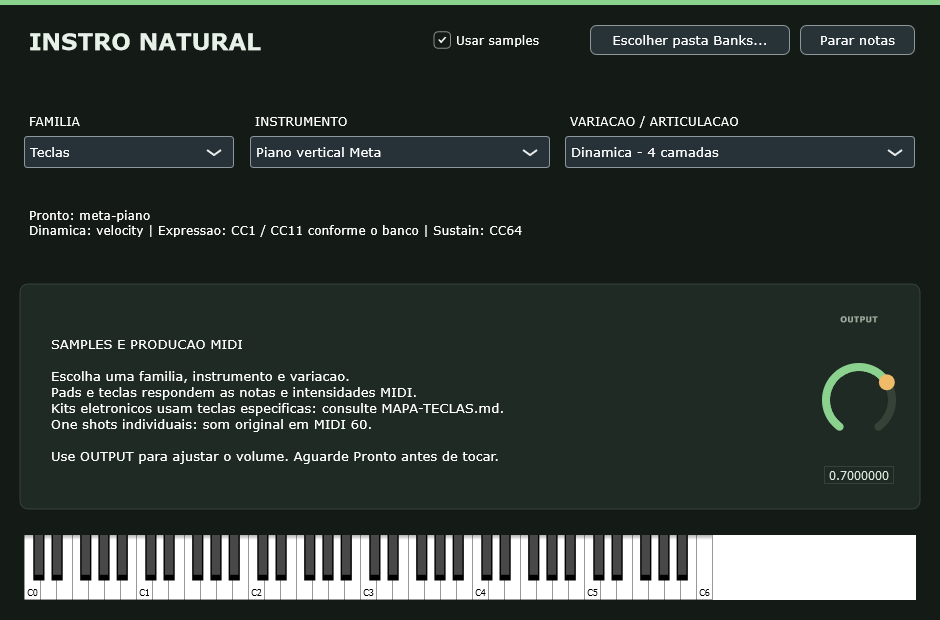

# Instro Natural

**Instrumento VST3 open source para Windows 64 bits**, desenvolvido para tocar gravações reais de instrumentos em faixas MIDI do Ableton Live 12 e outros hosts VST3.

**397 presets de samples · instrumentos acústicos, synths, 808s, pads e baterias · 80 timbres sintéticos adicionais**



## Novo: expansão Urban

149 presets de samples adicionados para produção de trap, emo trap, lo-fi, funk, pop e eletrônica. Inclui MS20, SK5, TX81Z, MiniFreak, Wavestate, Pro1, nove kits SR16 e 808s/bells/plucks originais. [Guia, limitações e licenças](docs/URBAN.md).

Para baixar só a expansão com o plugin, use `-Bancos urban` no script abaixo.

## Baixar e começar

**[Abrir a página de downloads da versão 0.4.0](https://github.com/tuofxit/Pluguin.Inst/releases/tag/v0.4.0)**

Você não precisa compilar o código para tocar. O pacote Windows já contém o VST3 e o aplicativo independente. Os bancos são baixados separadamente, então você pode começar apenas com piano ou violão.

### Opção 1: download organizado pelo script

1. **[Baixe o arquivo Baixar-Instro.ps1](https://github.com/tuofxit/Pluguin.Inst/releases/download/v0.4.0/Baixar-Instro.ps1)** e salve-o, por exemplo, em Downloads. O script pode ser lido [aqui](Baixar-Instro.ps1).
2. Abra o PowerShell na pasta onde salvou o arquivo.
3. Execute para baixar o aplicativo e todos os bancos:

```powershell
powershell -NoProfile -ExecutionPolicy Bypass -File .\Baixar-Instro.ps1
```

Isso cria a pasta **Instro-Natural** em Documentos. O script baixa os arquivos da release, confere os hashes SHA-256 e extrai cada banco na pasta correta. O parâmetro ExecutionPolicy vale apenas para esse processo de execução.

Para começar com menos downloads, escolha os bancos:

```powershell
# Apenas piano
powershell -NoProfile -ExecutionPolicy Bypass -File .\Baixar-Instro.ps1 -Bancos piano

# Violao de nylon e violao de aco
powershell -NoProfile -ExecutionPolicy Bypass -File .\Baixar-Instro.ps1 -Bancos violoes

# Guitarras eletricas e baixo
powershell -NoProfile -ExecutionPolicy Bypass -File .\Baixar-Instro.ps1 -Bancos 'guitarras,baixo'

# Escolher outra pasta e baixar tudo
powershell -NoProfile -ExecutionPolicy Bypass -File .\Baixar-Instro.ps1 -Destino 'D:\Instrumentos\Instro-Natural'
```

Os grupos disponíveis são `piano`, `violoes`, `guitarras`, `baixo`, `orquestra`, `extras` e `urban`. `todos` é o padrão. `nenhum` baixa apenas o aplicativo/plugin, permitindo usar o modo sintetizador sem samples. Você pode executar o script outra vez para acrescentar bancos; downloads completos já conferidos são reaproveitados.

**Espaço:** os WAVs ocupam cerca de 8,2 GB. Reserve **19 GB livres** para a biblioteca completa, os ZIPs e a extração. Após conferir a instalação, a subpasta `Downloads` criada pelo script pode ser apagada para liberar o espaço dos ZIPs.

### Opção 2: baixar e extrair manualmente

Na [Release 0.4.0](https://github.com/tuofxit/Pluguin.Inst/releases/tag/v0.4.0), baixe e extraia **Instro-Natural-Windows-x64.zip** em uma pasta chamada `Instro-Natural`. Baixe `Banco-Urban.zip` nesta release. Os bancos acústicos continuam disponíveis na [release 0.3.0](https://github.com/tuofxit/Pluguin.Inst/releases/tag/v0.3.0). Siga a tabela:

| Arquivo da release | Extrair dentro de |
|---|---|
| `Banco-Piano-Meta.zip` | `Instro-Natural/Banks/Meta-Piano` |
| `Banco-Violao-Nylon.zip` | `Instro-Natural/Banks/Meta-Nylon` |
| `Banco-Violao-Aco.zip` | `Instro-Natural/Banks/Meta-Steel` |
| `Banco-Guitarras-Eletricas.zip` | `Instro-Natural/Banks/Electric-Guitars` |
| `Banco-Baixo-Eletrico.zip` | `Instro-Natural/Banks/Electric-Bass` |
| **Todos** os ZIPs `Banco-Orquestra-*.zip` | `Instro-Natural/Banks/VSCO` — mesma pasta para todas as partes |
| `Banco-Urban.zip` | `Instro-Natural/Banks/Urban` |
| `Banco-VCSL.zip` | `Instro-Natural/Banks/VCSL` |

As partes da orquestra são ZIPs independentes: extraia todas na mesma pasta, preservando a estrutura. Mantenha o `catalog.json` fornecido no pacote Windows em `Banks`. Não mova apenas os arquivos WAV: os caminhos dos SFZ precisam ser preservados.

O botão **Code → Download ZIP** do repositório baixa o código-fonte. Para o plugin pronto e os sons, use os arquivos da **Release**.

## Usar no Ableton Live 12

1. Copie a pasta completa **Instro Natural.vst3**, que está em `VST3`, para `C:\Program Files\Common Files\VST3`. O Windows pode pedir permissão de administrador para essa cópia. Você também pode configurar a pasta `VST3` extraída como pasta personalizada de VST3 no Live.
2. Nas configurações de Plug-ins do Live, habilite a pasta correspondente e faça **Rescan**.
3. Adicione **Instro Natural** a uma **faixa MIDI**.
4. Na interface, clique em **Escolher pasta Banks...**, selecione a pasta `Banks` da instalação e escolha **família → instrumento → articulação**.
5. Aguarde **Pronto** e toque ou programe as notas.

O arquivo `.vst3` é um pacote: copie a pasta inteira, sem retirar o binário de dentro dela. Os bancos ficam fora da pasta VST3 do sistema.

[Instruções oficiais da Ableton para plugins VST no Windows](https://help.ableton.com/hc/en-us/articles/209071729-Using-VST-plug-ins-on-Windows).

## Criar um beat ou uma sequência MIDI

Crie um clipe MIDI no Live e desenhe as notas no piano roll, ou grave tocando um controlador. O instrumento escolhido no Instro reproduz essas notas. Ajuste a **velocity** para explorar a dinâmica das gravações.

Para uma produção com bateria, baixo, piano e violão, use uma instância do Instro em cada faixa MIDI. Você pode trocar o instrumento mantendo as mesmas notas. Para compartilhar o resultado com os sons, exporte o áudio pelo Ableton: um arquivo `.mid` guarda notas e controles, mas não guarda os samples nem o áudio.

O Instro toca o MIDI que você cria; ele não gera beats automaticamente.

## Experimentar sem uma DAW

Abra **Standalone/Instro Natural.exe**, configure a saída de áudio no painel do aplicativo e selecione a pasta `Banks`. Use o teclado da interface ou um controlador MIDI. A opção **Usar samples** usa samples; desativá-la libera os 80 timbres sintéticos e seus controles.

**[Baixar a demonstração em WAV](https://github.com/tuofxit/Pluguin.Inst/releases/download/v0.4.0/Demo-instrumentos.wav)** — 54 exemplos renderizados com os bancos da expansão Urban.

## Instrumentos e variações

- **Teclas:** pianos verticais, órgãos e cravos.
- **Cordas dedilhadas:** violões de nylon/aço, harpas e strumstick.
- **Guitarras/baixo:** Gretsch, Hofner e Jazz Bass, com mapeamentos como twang, staccato, hammer-on e notas limpas.
- **Cordas de arco:** violino solo, conjuntos de violinos, violas e cellos, e contrabaixo acústico; pizzicato, spiccato, tremolo e sustentados conforme o instrumento.
- **Sopros/metais:** flautas, piccolo, flautas doces, ocarina, gaita, clarinete, oboé, fagote, sax tenor, trompete, trombone, trompa e tuba.
- **Percussão:** tímpanos, kit orquestral, marimba, vibrafone, xilofone, glockenspiel, sinos, kalimbas, balafon, bongôs, conga, cajón, agogô e outros.

**[Catálogo dos bancos acústicos](docs/CATALOGO.md)** e **[catálogo Urban](docs/CATALOGO-URBAN.md)**. As 57 opções incluem combinações de guitarras e pianos alternativos; as 248 articulações/presets não são 248 instrumentos distintos.

## Estado da versão e testes

Esta é uma primeira versão experimental **0.4.0**, com binários Windows x64 compilados. Foram executados:

- **149/149 novos presets** da expansão Urban carregaram e produziram áudio em duas intensidades. Os **248/248 presets** acústicos anteriores foram validados na versão 0.3.0.
- Processador em **44,1/48 kHz**, com blocos de **64/1024/4096** frames.
- Salvamento/restauração do instrumento, recuperação de arquivo ausente e reprodução dos 80 timbres sintéticos.
- Renderização e inspeção da interface.
- **pluginval 1.0.4, nível 5: SUCCESS**, com testes de GUI desativados nessa ferramenta; a interface foi renderizada separadamente.

**Ainda não foi feita uma sessão de teste dentro do Ableton Live 12.** Os testes técnicos não substituem essa confirmação nem uma avaliação musical de toda a extensão de cada instrumento. [Resultados](docs/VALIDACAO.md) e [logs](validation).

## Limitações e solução de problemas

- Aguarde **Pronto** após abrir/trocar um instrumento. O carregamento ocorre em segundo plano.
- Mantenha os bancos em um local fixo, preferencialmente SSD. Seus caminhos são salvos no projeto da DAW. Se movê-los ou abrir em outro computador, selecione novamente Banks e o instrumento e salve o projeto.
- Sem som: confira o banco baixado, a seleção de instrumento, a saída de áudio, o armamento/monitoramento da faixa e a extensão de notas do instrumento. A pasta Banks precisa conter `catalog.json`.
- Cada instância toca um instrumento SFZ. Não há multitimbralidade ou MPE; para vários instrumentos, use várias faixas.
- Sustain, pitch bend, aftertouch, CC1 e CC11 dependem do mapeamento do banco. Nem todos os instrumentos implementam todos os controles.
- Os mapas VCSL desta versão não associam samples de soltura e não acrescentam loops artificiais de sustentação.
- Algumas modulações avançadas das guitarras Black And Green não são implementadas no sfizz 1.2.3. As gravações e articulações principais tocam, mas certos detalhes diferem do Sforzando.
- A seleção do preset natural é salva no projeto, mas ainda não é parâmetro de automação do host.
- Reduza OUTPUT se acordes fortes saturarem. As bibliotecas têm níveis e qualidade de gravação diferentes.

## Código-fonte e compilação

O repositório contém o código JUCE/C++ e o navegador de bancos. Os samples e os binários ficam nos assets da Release, fora do histórico Git. O pacote **[código com dependências](https://github.com/tuofxit/Pluguin.Inst/releases/download/v0.4.0/Instro-Natural-codigo-com-dependencias.zip)** também inclui os fontes do JUCE e do sfizz para recompilar sem baixá-los novamente.

Com Visual Studio 2022 e a carga Desktop C++, CMake 3.22+ e Git:

```powershell
git clone https://github.com/tuofxit/Pluguin.Inst.git
cd Pluguin.Inst
cmake -S . -B build -A x64
cmake --build build --config Release --target Instro_VST3 Instro_Standalone
```

O CMake obtém JUCE 9.0.4 e sfizz 1.2.3 quando as dependências não estão presentes. **[Detalhes de compilação e testes](docs/COMPILAR.md).**

## Créditos e licenças

| Componente | Fonte | Licença |
|---|---|---|
| Código Instro Natural | Este repositório | AGPL-3.0-or-later |
| JUCE 9.0.4 | [JUCE](https://github.com/juce-framework/JUCE) | Opção aberta AGPLv3; outros avisos nos fontes |
| sfizz 1.2.3 | [sfztools/sfizz](https://github.com/sfztools/sfizz) | BSD-2-Clause e licenças das dependências |
| Piano e violões Meta | [Meta Open Sound](https://github.com/facebookincubator/Meta-open-sound) | CC0 |
| Orquestra | [VSCO 2 Community Edition](https://github.com/sgossner/VSCO-2-CE) | CC0 |
| Instrumentos extras | [VCSL / Versilian Studios](https://github.com/sgossner/VCSL) | CC0 |
| Guitarras elétricas | [Karoryfer Black And Green Guitars](https://github.com/sfzinstruments/karoryfer.black-and-green-guitars) | CC0 |
| Synths e baterias Frequency303 | [Allan Legemaate](https://www.frequency303.com/samples/) | CC0 |
| Pads, leads e SR16 | [SHLD / Ludovic Drolez](https://drolez.com/blog/music/ableton-free-sound-packs.php) | CC0-1.0 |
| 808s, bells/plucks e MIDI originais | Este projeto | CC0-1.0 |
| Baixo elétrico | [Karoryfer Growlybass](https://github.com/sfzinstruments/karoryfer.growlybass) | CC0 |

As gravações pertencem aos respectivos autores e foram reutilizadas sob suas licenças abertas. Os mapeamentos VCSL e as opções de seleção do violão de nylon foram adaptados para este projeto. A licença do programa é separada da licença dos samples. Consulte [LICENSE](LICENSE), [avisos das dependências](Licenses) e [fontes/hashes dos bancos](docs/SAMPLE-SOURCES.json).

Ableton Live é produto da Ableton. Este projeto é independente e não é um produto oficial da Ableton.
